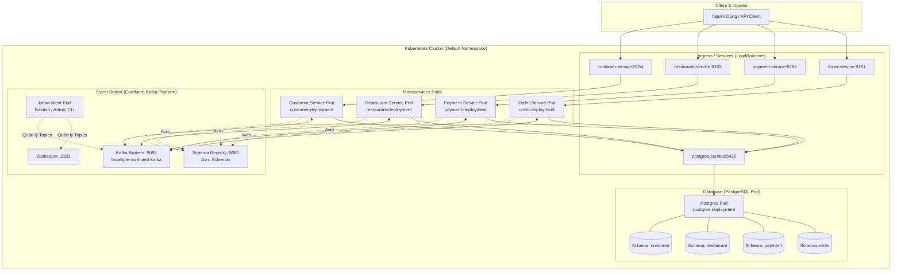
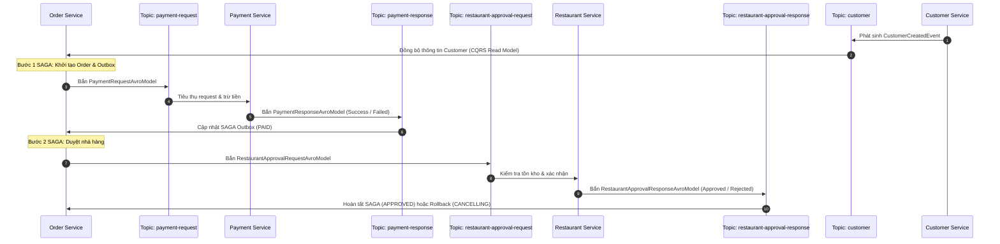

# TÀI LIỆU GIẢI THÍCH CHI TIẾT HẠ TẦNG DỰ ÁN (INFRASTRUCTURE REPO)
## FOOD ORDERING SYSTEM MICROSERVICES

---

## MỤC LỤC
1. [Tổng Quan Kiến Trúc Hạ Tầng](#1-tổng-quan-kiến-trúc-hạ-tầng)
2. [Bản Đồ Thành Phần & Danh Sách File](#2-bản-đồ-thành-phần--danh-sách-file)
3. [Giải Thích Chi Tiết Từng File & Code](#3-giải-thích-chi-tiết-từng-file--code)
   - [3.1. postgres-deployment.yml](#31-postgres-deploymentyml)
   - [3.2. kafka-client.yml](#32-kafka-clientyml)
   - [3.3. create-topics.sh](#33-create-topicssh)
   - [3.4. tag-and-push-images.sh](#34-tag-and-push-imagessh)
   - [3.5. application-deployment-local.yml](#35-application-deployment-localyml)
   - [3.6. application-deployment.yml](#36-application-deploymentyml)
   - [3.7. Thư mục helm/cp-helm-charts](#37-thư-mục-helmcp-helm-charts)
   - [3.8. Các file cấu hình phụ trợ](#38-các-file-cấu-hình-phụ-trợ)
4. [So Sánh Chi Tiết: Local Deployment vs. Cloud GKE Deployment](#4-so-sánh-chi-tiết-local-deployment-vs-cloud-gke-deployment)
5. [Quy Trình Triển Khai Thực Tế (Step-by-Step Runbook)](#5-quy-trình-triển-khai-thực-tế-step-by-step-runbook)
6. [Bảng Tra Cứu Nhanh (Cheatsheet)](#6-bảng-tra-cứu-nhanh-cheatsheet)

---

## 1. TỔNG QUAN KIẾN TRÚC HẠ TẦNG

Repository **`food-ordering-system-infra`** chứa toàn bộ mã nguồn khai báo hạ tầng (Infrastructure as Code - IaC) phục vụ cho hệ thống đặt đồ ăn theo kiến trúc Microservices (Clean Architecture, DDD, SAGA Pattern, Outbox Pattern, CQRS, Apache Kafka, PostgreSQL trên nền tảng **Kubernetes**).

### 1.1. Sơ đồ kiến trúc tổng thể trên Kubernetes Cluster



### 1.2. Luồng giao tiếp Event-Driven qua Kafka Topics (SAGA & Outbox)



---

## 2. BẢN ĐỒ THÀNH PHẦN & DANH SÁCH FILE

| STT | Tên File / Thư Mục | Loại | Mục Đích Chính |
|:---:|:---|:---:|:---|
| 1 | [`postgres-deployment.yml`](file:///c:/Users/leduc/Documents/micro/food-ordering-system-infra/postgres-deployment.yml) | K8s Manifest | Triển khai CSDL PostgreSQL và Service kết nối cho toàn bộ 4 service |
| 2 | [`kafka-client.yml`](file:///c:/Users/leduc/Documents/micro/food-ordering-system-infra/kafka-client.yml) | K8s Manifest | Tạo một Pod tiện ích làm "bàn đạp" (bastion) chạy các lệnh Kafka CLI |
| 3 | [`create-topics.sh`](file:///c:/Users/leduc/Documents/micro/food-ordering-system-infra/create-topics.sh) | Shell Script | Tự động xóa (nếu có) và tạo mới 5 Kafka topics phục vụ SAGA & CQRS |
| 4 | [`tag-and-push-images.sh`](file:///c:/Users/leduc/Documents/micro/food-ordering-system-infra/tag-and-push-images.sh) | Shell Script | Gắn tag ảnh Docker cục bộ và đẩy lên Google Cloud Artifact Registry |
| 5 | [`application-deployment-local.yml`](file:///c:/Users/leduc/Documents/micro/food-ordering-system-infra/application-deployment-local.yml) | K8s Manifest | Triển khai 4 microservices lên Kubernetes Local (Docker Desktop / Minikube) |
| 6 | [`application-deployment.yml`](file:///c:/Users/leduc/Documents/micro/food-ordering-system-infra/application-deployment.yml) | K8s Manifest | Triển khai 4 microservices lên Google Kubernetes Engine (GKE) có tích hợp HPA (Autoscaling) |
| 7 | [`helm/cp-helm-charts`](file:///c:/Users/leduc/Documents/micro/food-ordering-system-infra/helm/cp-helm-charts) | Helm Charts | Thư mục submodule chứa Helm Charts của Confluent Kafka Platform |
| 8 | [`README.md`](file:///c:/Users/leduc/Documents/micro/food-ordering-system-infra/README.md) | Tài liệu | Mô tả ngắn gọn về nguồn gốc dự án từ khóa học Udemy |
| 9 | [`food-ordering-system-infra.iml`](file:///c:/Users/leduc/Documents/micro/food-ordering-system-infra/food-ordering-system-infra.iml) | IDE Config | File dự án IntelliJ IDEA |

---

## 3. GIẢI THÍCH CHI TIẾT TỪNG FILE & CODE

---

### 3.1. `postgres-deployment.yml`

File này định nghĩa 2 tài nguyên Kubernetes: một **Deployment** chạy container PostgreSQL và một **Service** phơi cổng ra mạng nội bộ/bên ngoài cluster.

```yaml
---
apiVersion: apps/v1
kind: Deployment
metadata:
  name: postgres-deployment
  namespace: default
  labels:
    app: postgres-deployment
spec:
  selector:
    matchLabels:
      app: postgres-deployment
  template:
    metadata:
      labels:
        app: postgres-deployment
    spec:
      containers:
        - name: postgres
          image: postgres:latest
          env:
            - name: POSTGRES_PASSWORD
              value: "admin"
---
apiVersion: v1
kind: Service
metadata:
  name: postgres-service
  namespace: default
  labels:
    app: postgres-deployment
spec:
  selector:
    app: postgres-deployment
  ports:
    - name: postgres-service-port
      protocol: TCP
      port: 5432
  type: LoadBalancer
  loadBalancerIP: ""
```

#### Giải thích chi tiết từng phần:

1. **Phần `Deployment` (Dòng 1 - 23):**
   - `kind: Deployment`: Quản lý vòng đời (lifecycle), số lượng replica và nâng cấp cho các Pods chạy database.
   - `name: postgres-deployment`: Tên định danh của Deployment trong namespace `default`.
   - `image: postgres:latest`: Sử dụng image Docker PostgreSQL chính thức mới nhất.
   - `env:`:
     - `POSTGRES_PASSWORD: "admin"`: Thiết lập mật khẩu mặc định cho siêu tài khoản `postgres`. Tên người dùng mặc định là `postgres`.
   - *Lưu ý kiến trúc*: Cả 4 microservice đều dùng chung 1 container DB này nhưng mỗi service lưu dữ liệu ở một **PostgreSQL Schema riêng biệt** (`order`, `payment`, `restaurant`, `customer`). Đây là mô hình **Database-per-service via Schema Isolation**, giúp tiết kiệm tài nguyên khi học tập/kiểm thử cục bộ nhưng vẫn đảm bảo tính độc lập dữ liệu giữa các microservices.

2. **Phần `Service` (Dòng 24 - 40):**
   - `name: postgres-service`: Tên của service. Tên này cực kỳ quan trọng vì Kubernetes DNS sẽ tạo bản ghi nội bộ `postgres-service:5432`. Bất kỳ container nào trong cluster đều có thể kết nối tới DB bằng hostname này.
   - `selector: app: postgres-deployment`: Định tuyến lưu lượng đến các Pod có nhãn `app: postgres-deployment`.
   - `port: 5432`: Cổng lắng nghe chuẩn của PostgreSQL.
   - `type: LoadBalancer`:
     - Trên môi trường local (như Docker Desktop K8s hoặc Minikube tunnel), nó sẽ ánh xạ cổng `5432` trực tiếp ra máy host `localhost:5432`, giúp lập trình viên dùng DBeaver / pgAdmin từ máy thật kết nối vào kiểm tra bảng và dữ liệu.
     - Trên Cloud (GKE), K8s sẽ xin một địa chỉ IP công cộng (hoặc nội bộ tùy cấu hình cloud).

---

### 3.2. `kafka-client.yml`

File này tạo ra một Pod chạy container Kafka độc lập làm trạm trung gian (Bastion/Jumpbox).

```yaml
apiVersion: v1
kind: Pod
metadata:
  name: kafka-client
  namespace: default
spec:
  containers:
    - name: kafka-client
      image: confluentinc/cp-enterprise-kafka:6.1.0
      volumeMounts:
        - name: kafka-client-storage
          mountPath: /kafka-client-storage
      command:
        - sh
        - -c
        - "exec tail -f /dev/null"
  volumes:
    - name: kafka-client-storage
```

#### Giải thích chi tiết:

- **Tại sao cần file này?**
  Khi chạy Kafka cluster bằng Confluent Helm Chart trên Kubernetes, các broker và zookeeper nằm ẩn bên trong mạng SDN của cluster. Người phát triển cần một nơi có sẵn các công cụ dòng lệnh (CLI tools như `kafka-topics`, `kafka-console-consumer`, v.v.) mà không cần cài đặt Kafka SDK lên máy thật.
- `image: confluentinc/cp-enterprise-kafka:6.1.0`: Image doanh nghiệp của Confluent chứa đầy đủ các công cụ quản trị CLI của Kafka.
- `command: ["sh", "-c", "exec tail -f /dev/null"]`:
  - Lệnh này là một thủ thuật kinh điển trong Docker/K8s. Nó giữ cho tiến trình chính không bao giờ kết thúc (bằng cách đọc vô tận file rỗng `/dev/null`). Nhờ đó, Pod luôn ở trạng thái `Running` để lập trình viên có thể dùng lệnh:
    ```bash
    kubectl exec -it kafka-client -- /bin/bash
    ```
    vào bên trong container và gõ lệnh kiểm tra topic, kiểm tra tin nhắn.
- `volumeMounts` & `volumes`: Gắn ổ đĩa rỗng tạm thời (EmptyDir mặc định) tại `/kafka-client-storage` để lưu trữ script hoặc file cấu hình tạm khi cần.

---

### 3.3. `create-topics.sh`

Script shell tự động hóa việc khởi tạo 5 Kafka topics phục vụ hệ thống.

```bash
#local-confluent-kafka-cp-zookeeper-headless
kafka-topics --zookeeper $1:2181 --topic payment-request --delete --if-exists
kafka-topics --zookeeper $1:2181 --topic payment-response --delete --if-exists
kafka-topics --zookeeper $1:2181 --topic restaurant-approval-request --delete --if-exists
kafka-topics --zookeeper $1:2181 --topic restaurant-approval-response --delete --if-exists
kafka-topics --zookeeper $1:2181 --topic customer --delete --if-exists

kafka-topics --zookeeper $1:2181 --topic payment-request --create --partitions 3 --replication-factor 3 --if-not-exists
kafka-topics --zookeeper $1:2181 --topic payment-response --create --partitions 3 --replication-factor 3 --if-not-exists
kafka-topics --zookeeper $1:2181 --topic restaurant-approval-request --create --partitions 3 --replication-factor 3 --if-not-exists
kafka-topics --zookeeper $1:2181 --topic restaurant-approval-response --create --partitions 3 --replication-factor 3 --if-not-exists
kafka-topics --zookeeper $1:2181 --topic customer --create --partitions 3 --replication-factor 3 --if-not-exists
```

#### Giải thích chi tiết từng tham số:

1. **Biến tham số `$1`:**
   - Đại diện cho địa chỉ host của Zookeeper.
   - Khi chạy trên local: `$1` thường truyền vào `local-confluent-kafka-cp-zookeeper-headless`.
   - Khi chạy trên GKE: `$1` thường truyền vào `gke-confluent-kafka-cp-zookeeper-headless`.
   - Cổng mặc định của Zookeeper là `2181`.

2. **Khối lệnh xóa (Dòng 2 - 6):**
   - `--delete --if-exists`: Xóa sạch các topic cũ (nếu đã tồn tại) để khởi động hệ thống với trạng thái sạch (clean state), tránh còn sót tin nhắn cũ gây xung đột nghiệp vụ SAGA khi chạy test.

3. **Khối lệnh tạo mới (Dòng 8 - 12):**
   - `--create`: Lệnh tạo topic.
   - `--partitions 3`:
     - Chia mỗi topic thành **3 partitions**.
     - Giúp phân tán tải dữ liệu (load balancing), cho phép tối đa 3 consumer instances trong cùng một Consumer Group đọc dữ liệu song song (parallel processing).
     - Đảm bảo thứ tự tin nhắn (message ordering) theo Partition Key (ví dụ `customerId` hoặc `orderId`).
   - `--replication-factor 3`:
     - Nhân bản mỗi partition lên **3 bản sao** trên 3 broker khác nhau.
     - Đảm bảo tính sẵn sàng cao (High Availability - HA) và chịu lỗi (Fault Tolerance). Ngay cả khi 1 hoặc 2 broker gặp sự cố, dữ liệu vẫn an toàn.
   - `--if-not-exists`: Tránh sinh lỗi nếu topic đã tồn tại.

4. **Ý nghĩa nghiệp vụ của 5 Topics:**
   - **`payment-request`**: `order-service` đẩy thông điệp yêu cầu thanh toán cho đơn hàng.
   - **`payment-response`**: `payment-service` phản hồi kết quả thanh toán (thành công hoặc hết tiền/thất bại).
   - **`restaurant-approval-request`**: `order-service` gửi yêu cầu nhà hàng duyệt đơn hàng.
   - **`restaurant-approval-response`**: `restaurant-service` gửi phản hồi xác nhận đơn (được duyệt hoặc hết món).
   - **`customer`**: `customer-service` phát thông báo tạo mới tài khoản khách hàng để `order-service` lưu bản sao thông tin cục bộ (áp dụng mô hình CQRS Read-Side).

---

### 3.4. `tag-and-push-images.sh`

Script dùng để triển khai lên môi trường Google Cloud (GCP).

```bash
gcloud auth login

docker tag com.food.ordering.system/order.service:$1 europe-west4-docker.pkg.dev/food-ordering-system-346904/food-ordering-system-repository/order.service:$1
docker tag com.food.ordering.system/payment.service:$1 europe-west4-docker.pkg.dev/food-ordering-system-346904/food-ordering-system-repository/payment.service:$1
docker tag com.food.ordering.system/restaurant.service:$1 europe-west4-docker.pkg.dev/food-ordering-system-346904/food-ordering-system-repository/restaurant.service:$1
docker tag com.food.ordering.system/customer.service:$1 europe-west4-docker.pkg.dev/food-ordering-system-346904/food-ordering-system-repository/customer.service:$1

docker push europe-west4-docker.pkg.dev/food-ordering-system-346904/food-ordering-system-repository/order.service:$1
docker push europe-west4-docker.pkg.dev/food-ordering-system-346904/food-ordering-system-repository/payment.service:$1
docker push europe-west4-docker.pkg.dev/food-ordering-system-346904/food-ordering-system-repository/restaurant.service:$1
docker push europe-west4-docker.pkg.dev/food-ordering-system-346904/food-ordering-system-repository/customer.service:$1
```

#### Giải thích chi tiết:

1. **`gcloud auth login`**: Mở trình duyệt để người dùng đăng nhập tài khoản Google Cloud và lấy quyền xác thực truy cập GCP project.
2. **Biến `$1`**: Là số phiên bản (version tag) của Docker image, ví dụ `1.0-SNAPSHOT` hoặc `latest`.
3. **Cơ chế `docker tag` & `docker push`**:
   - Khi build cục bộ bằng Maven/Gradle (Jib plugin hoặc Dockerfile), image có tên cục bộ là:
     `com.food.ordering.system/<service>:$1`
   - Để đẩy lên Google Cloud, ảnh bắt buộc phải được gắn URL kho chứa Artifact Registry của GCP:
     `europe-west4-docker.pkg.dev/food-ordering-system-346904/food-ordering-system-repository/<service>:$1`
     - `europe-west4`: Region trung tâm dữ liệu GCP (Eemshaven, Hà Lan).
     - `food-ordering-system-346904`: Project ID trên GCP.
     - `food-ordering-system-repository`: Tên kho lưu trữ Docker repository trong Artifact Registry.
   - Lệnh `docker push` tải ảnh lên máy chủ GCP để Kubernetes cluster trên Cloud (GKE) có thể kéo (pull) về khi chạy Pods.

---

### 3.5. `application-deployment-local.yml`

File này chứa toàn bộ cấu hình khai báo K8s để chạy đồng thời cả **4 Spring Boot Microservices** trên môi trường máy cá nhân (Localhost / Minikube / Docker Desktop).

Cấu trúc gồm 4 cặp: `Deployment` và `Service` cho từng dịch vụ:
- `order-deployment` & `order-service` (Cổng 8181)
- `payment-deployment` & `payment-service` (Cổng 8182)
- `restaurant-deployment` & `restaurant-service` (Cổng 8183)
- `customer-deployment` & `customer-service` (Cổng 8184)

#### Phân tích mẫu cho `order-service` (các service khác có cấu trúc tương tự):

```yaml
apiVersion: apps/v1
kind: Deployment
metadata:
  name: order-deployment
  namespace: default
  labels:
    app: order-deployment
spec:
  selector:
    matchLabels:
      app: order-deployment
  template:
    metadata:
      labels:
        app: order-deployment
    spec:
      containers:
        - name: order-service
          image: com.food.ordering.system/order.service:1.0-SNAPSHOT
          env:
            - name: SPRING_DATASOURCE_URL
              value: "jdbc:postgresql://postgres-service:5432/postgres?currentSchema=order&binaryTransfer=true&reWriteBatchedInserts=true&stringtype=unspecified"
            - name: KAFKA-CONFIG_BOOTSTRAP-SERVERS
              value: "local-confluent-kafka-cp-kafka-headless:9092"
            - name: KAFKA-CONFIG_SCHEMA-REGISTRY-URL
              value: "http://local-confluent-kafka-cp-schema-registry:8081"
          resources:
            limits:
              cpu: "500m"
              memory: "1024Mi"
            requests:
              cpu: "200m"
              memory: "256Mi"
```

#### Giải thích sâu các thuộc tính:

1. **`image: com.food.ordering.system/order.service:1.0-SNAPSHOT`**:
   - Sử dụng Docker image được build cục bộ trên máy. K8s local sẽ lấy trực tiếp image từ Docker daemon mà không cần tải qua internet.

2. **Biến môi trường `SPRING_DATASOURCE_URL`:**
   ```text
   jdbc:postgresql://postgres-service:5432/postgres?currentSchema=order&binaryTransfer=true&reWriteBatchedInserts=true&stringtype=unspecified
   ```
   - `postgres-service:5432`: Tên miền nội bộ trỏ tới Service của PostgreSQL đã tạo ở file `postgres-deployment.yml`.
   - `/postgres`: Tên database mặc định.
   - `currentSchema=order`: **Điểm cốt lõi!** Báo cho Hibernate / Spring Data JPA biết toàn bộ các bảng của `order-service` sẽ nằm riêng trong Schema `order` (tương tự `currentSchema=payment`, `restaurant`, `customer` ở các service khác).
   - `binaryTransfer=true`: Tối ưu hiệu năng truyền dữ liệu nhị phân giữa Java và PostgreSQL.
   - `reWriteBatchedInserts=true`: Bật tính năng tối ưu ghi theo batch của driver PostgreSQL. Khi lưu Outbox messages hoặc nhiều dòng dữ liệu, JDBC driver sẽ gom thành một câu lệnh SQL duy nhất thay vì thực thi từng dòng, tăng tốc độ ghi lên 3-5 lần.
   - `stringtype=unspecified`: Hỗ trợ ánh xạ kiểu dữ liệu linh hoạt (đặc biệt khi lưu UUID hoặc kiểu JSONB/Enum của Postgres).

3. **Cấu hình Kafka:**
   - `KAFKA-CONFIG_BOOTSTRAP-SERVERS`: `local-confluent-kafka-cp-kafka-headless:9092` trỏ tới cụm Kafka broker nội bộ K8s do Helm chart tạo ra.
   - `KAFKA-CONFIG_SCHEMA-REGISTRY-URL`: `http://local-confluent-kafka-cp-schema-registry:8081` trỏ tới Confluent Schema Registry để xác thực và tải cấu trúc Schema Avro khi tuần tự hóa (serialize) hoặc giải tuần tự hóa (deserialize) tin nhắn Kafka.

4. **Giới hạn tài nguyên (Resources):**
   - `requests:`: Mức tài nguyên tối thiểu K8s cam kết cấp phát khi khởi động Pod:
     - `cpu: 200m` (0.2 CPU core)
     - `memory: 256Mi` (256 Megabytes RAM)
   - `limits:`: Mức tài nguyên trần tối đa Pod được phép tiêu thụ:
     - `cpu: 500m` (0.5 CPU core)
     - `memory: 1024Mi` (1 Gigabyte RAM). Tránh trường hợp JVM bị rò rỉ bộ nhớ làm treo toàn bộ máy lập trình viên.

5. **Phần `Service` (Port 8181):**
   ```yaml
   apiVersion: v1
   kind: Service
   metadata:
     name: order-service
   spec:
     ports:
       - port: 8181
     type: LoadBalancer
   ```
   - Ánh xạ cổng 8181 của container ra bên ngoài máy host. Lập trình viên có thể dùng Postman gọi thẳng `http://localhost:8181/orders` để tạo đơn hàng.

---

### 3.6. `application-deployment.yml`

File này dùng để triển khai lên môi trường **Production / Google Kubernetes Engine (GKE)**.

#### Điểm khác biệt quan trọng so với file local:

1. **Nguồn Docker Image:**
   - Đổi từ tên image cục bộ sang image trên GCP Artifact Registry:
     ```yaml
     image: europe-west4-docker.pkg.dev/food-ordering-system-346904/food-ordering-system-repository/order.service:1.0-SNAPSHOT
     ```

2. **Tắt chế độ tự khởi tạo CSDL:**
   - Bổ sung thêm biến môi trường:
     ```yaml
     - name: SPRING_DATASOURCE_INITIALIZATION-MODE
       value: "never"
     ```
   - **Tại sao?**
     Ở môi trường production có nhiều Pod chạy đồng thời (Replicas >= 2). Nếu để Spring Boot tự động chạy file `schema.sql` hoặc `data.sql` khi Pod khởi động, các Pod sẽ tranh chấp và cố gắng tạo lại bảng cùng lúc (Race condition / DDL lock). Do đó, trên GKE, việc tạo bảng được chạy một lần trước đó (qua migration tool như Flyway/Liquibase hoặc thủ công), còn Spring Boot chỉ tập trung vào xử lý nghiệp vụ.

3. **Địa chỉ Kafka trên GKE:**
   - Tiền tố đổi từ `local-confluent-kafka` sang `gke-confluent-kafka`:
     ```yaml
     - name: KAFKA-CONFIG_BOOTSTRAP-SERVERS
       value: "gke-confluent-kafka-cp-kafka-headless:9092"
     - name: KAFKA-CONFIG_SCHEMA-REGISTRY-URL
       value: "http://gke-confluent-kafka-cp-schema-registry:8081"
     ```

4. **Tự động mở rộng Pod với HorizontalPodAutoscaler (HPA):**
   Mỗi microservice đều có một cấu hình HPA đi kèm:
   ```yaml
   apiVersion: autoscaling/v2beta1
   kind: HorizontalPodAutoscaler
   metadata:
     name: order-deployment-hpa
     namespace: default
     labels:
       app: order-deployment
   spec:
     scaleTargetRef:
       kind: Deployment
       name: order-deployment
       apiVersion: apps/v1
     minReplicas: 2
     maxReplicas: 4
     metrics:
       - type: Resource
         resource:
           name: cpu
           targetAverageUtilization: 85
   ```
   - `minReplicas: 2`: Luôn luôn duy trì tối thiểu 2 Pods hoạt động song song để đảm bảo tính sẵn sàng cao (High Availability). Nếu 1 Pod bị chết, hệ thống vẫn phục vụ bình thường.
   - `maxReplicas: 4`: Khi lưu lượng truy cập tăng vọt, K8s được phép mở rộng tối đa lên 4 Pods.
   - `targetAverageUtilization: 85`: Nếu mức tiêu thụ CPU trung bình của các Pod vượt quá **85%** mức request (`200m`), K8s sẽ tự động sinh thêm Pod mới. Khi tải giảm, K8s sẽ tự động hủy bớt Pod để tiết kiệm chi phí cloud.

---

### 3.7. Thư mục `helm/cp-helm-charts`

- Đây là thư mục chứa **Confluent Platform Helm Charts** (thường được tích hợp dưới dạng Git Submodule hoặc tải từ kho Helm của Confluent).
- **Mục đích**:
  Thay vì phải tự viết hàng chục file YAML phức tạp để cài đặt Zookeeper, Kafka Brokers đa nút (multi-node), Confluent Schema Registry, Kafka REST Proxy, Kafka Connect và Control Center; người quản trị chỉ cần dùng công cụ **Helm** với câu lệnh:
  ```bash
  # Cài đặt Kafka cho môi trường local:
  helm install local-confluent-kafka helm/cp-helm-charts

  # Cài đặt Kafka cho môi trường Cloud GKE:
  helm install gke-confluent-kafka helm/cp-helm-charts
  ```
- Tên phát hành (`Release Name`) `local-confluent-kafka` hoặc `gke-confluent-kafka` chính là tiền tố quyết định tên DNS nội bộ trong Kubernetes (ví dụ: `local-confluent-kafka-cp-kafka-headless`).

---

### 3.8. Các file cấu hình phụ trợ

1. **`README.md`**:
   - Ghi lại thông tin dự án thuộc khóa học *"Microservices: Clean Architecture, DDD, SAGA, Outbox & Kafka"* của tác giả Ali Gelenler trên Udemy.
2. **`food-ordering-system-infra.iml` & `.idea/`**:
   - Đây là các file cấu hình dự án của IDE JetBrains IntelliJ IDEA (`.idea/modules.xml`, `.idea/vcs.xml`, v.v.). Chúng giúp IntelliJ nhận diện thư mục này như một project trong workspace.

---

## 4. SO SÁNH CHI TIẾT: LOCAL DEPLOYMENT VS. CLOUD GKE DEPLOYMENT

| Tiêu Chí | Local (`application-deployment-local.yml`) | Cloud GKE (`application-deployment.yml`) |
|:---|:---|:---|
| **Mục đích** | Phát triển, kiểm thử nhanh trên máy cá nhân | Triển khai thực tế trên Google Cloud Platform |
| **Docker Images** | Ảnh nội bộ: `com.food.ordering.system/*:1.0-SNAPSHOT` | Google Artifact Registry: `europe-west4-docker.pkg.dev/.../*:1.0-SNAPSHOT` |
| **Kafka Bootstrap Server** | `local-confluent-kafka-cp-kafka-headless:9092` | `gke-confluent-kafka-cp-kafka-headless:9092` |
| **Schema Registry URL** | `http://local-confluent-kafka-cp-schema-registry:8081` | `http://gke-confluent-kafka-cp-schema-registry:8081` |
| **DB Initialization** | Để mặc định (cho phép chạy script nạp dữ liệu ban đầu) | Đặt cứng `never` để chống xung đột race condition giữa các replica |
| **Số lượng Replica** | 1 Pod duy nhất cho mỗi service | Tối thiểu 2 Pods, tối đa 4 Pods |
| **Khả năng tự co giãn (Autoscaling)** | Không cấu hình HPA | Có cấu hình `HorizontalPodAutoscaler` co giãn theo CPU 85% |

---

## 5. QUY TRÌNH TRIỂN KHAI THỰC TẾ (STEP-BY-STEP RUNBOOK)

Dưới đây là các bước chuẩn xác để khởi động toàn bộ hạ tầng này:

### Bước 1: Khởi động cơ sở dữ liệu PostgreSQL
```bash
kubectl apply -f postgres-deployment.yml
```
*Kiểm tra:* Chờ cho đến khi Pod `postgres-deployment-...` ở trạng thái `Running`:
```bash
kubectl get pods -l app=postgres-deployment
```

### Bước 2: Cài đặt Kafka & Zookeeper Cluster bằng Helm
```bash
# Đối với môi trường Local:
helm install local-confluent-kafka helm/cp-helm-charts

# Hoặc đối với môi trường GKE:
helm install gke-confluent-kafka helm/cp-helm-charts
```

### Bước 3: Khởi tạo Pod kafka-client và tạo các Topics
1. Bật pod client:
   ```bash
   kubectl apply -f kafka-client.yml
   ```
2. Sao chép file script tạo topic vào trong pod `kafka-client`:
   ```bash
   kubectl cp create-topics.sh kafka-client:/kafka-client-storage/create-topics.sh
   ```
3. Chạy script tạo 5 topics bên trong pod (truyền tên zookeeper service làm tham số):
   ```bash
   # Với Local:
   kubectl exec -it kafka-client -- /bin/bash -c "chmod +x /kafka-client-storage/create-topics.sh && /kafka-client-storage/create-topics.sh local-confluent-kafka-cp-zookeeper-headless"

   # Với GKE:
   kubectl exec -it kafka-client -- /bin/bash -c "chmod +x /kafka-client-storage/create-topics.sh && /kafka-client-storage/create-topics.sh gke-confluent-kafka-cp-zookeeper-headless"
   ```

### Bước 4: Triển khai 4 Microservices
```bash
# Nếu chạy trên Local (Docker Desktop / Minikube):
kubectl apply -f application-deployment-local.yml

# Nếu chạy trên Cloud GKE:
kubectl apply -f application-deployment.yml
```

### Bước 5: Kiểm tra trạng thái toàn cụm
```bash
# Xem danh sách Pods
kubectl get pods

# Xem danh sách Services và cổng được mở ra ngoài
kubectl get svc

# Xem trạng thái tự co giãn HPA (trên GKE)
kubectl get hpa
```

---

## 6. BẢNG TRA CỨU NHANH (CHEATSHEET)

### 6.1. Danh Sách Cổng (Port Mapping)

| Dịch Vụ | Cổng Service (Host/External) | Cổng Container | Giao Thức |
|:---|:---:|:---:|:---:|
| **Order Service** | `8181` | `8181` | HTTP / REST |
| **Payment Service** | `8182` | `8182` | HTTP / REST |
| **Restaurant Service** | `8183` | `8183` | HTTP / REST |
| **Customer Service** | `8184` | `8184` | HTTP / REST |
| **PostgreSQL Database** | `5432` | `5432` | TCP (PostgreSQL) |
| **Kafka Broker** | `9092` | `9092` | TCP (Kafka PLAINTEXT) |
| **Confluent Schema Registry** | `8081` | `8081` | HTTP |
| **Zookeeper** | `2181` | `2181` | TCP |

### 6.2. Cấu Trúc Database Schemas

Tất cả dịch vụ kết nối vào database `postgres`, phân định logic theo `currentSchema`:
- `order`: Chứa bảng `orders`, `order_items`, `order_address`, `payment_outbox`, `restaurant_approval_outbox`, `customers` (read model).
- `payment`: Chứa bảng `payments`, `credit_entries`, `credit_histories`, `order_outbox`.
- `restaurant`: Chứa bảng `restaurants`, `products`, `order_approvals`, `order_outbox`.
- `customer`: Chứa bảng `customers`.

### 6.3. Kafka Topics & Mô Hình Dữ Liệu

| Tên Topic | Producer | Consumer | Dữ Liệu Truyền Tải (Avro Schema) |
|:---|:---|:---|:---|
| `payment-request` | `order-service` | `payment-service` | `PaymentRequestAvroModel` |
| `payment-response` | `payment-service` | `order-service` | `PaymentResponseAvroModel` |
| `restaurant-approval-request` | `order-service` | `restaurant-service` | `RestaurantApprovalRequestAvroModel` |
| `restaurant-approval-response` | `restaurant-service` | `order-service` | `RestaurantApprovalResponseAvroModel` |
| `customer` | `customer-service` | `order-service` | `CustomerAvroModel` |
